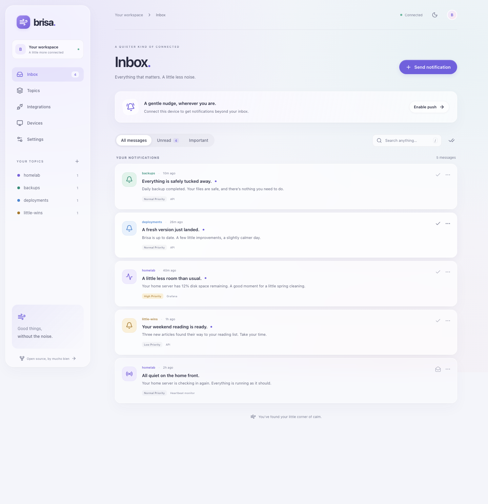

# Brisa

**A quieter home for your notifications.**

Brisa is an open-source notification inbox you deploy to your own Cloudflare
account. Send a small HTTP request from a script, connect Grafana, or watch for a
missed heartbeat. Receive Web Push on your phone and desktop without building a
native app.



- Topics, priorities, search, and a shared read/unread inbox.
- Encrypted Web Push and topic subscriptions for multiple devices.
- Topic-scoped, revocable publishing keys, shown only when created.
- Grafana firing/resolved webhooks with deduplication.
- Heartbeat monitoring independent of the monitored machine.
- Durable delivery records, queue retries, expired-subscription cleanup, and
  30-day message history.
- A custom glass design system with light/dark appearances, mobile navigation,
  reduced-motion support, and an installable PWA powered by `vite-plugin-pwa`.

One installation is **one trusted workspace**. Its access key grants full
management access. Topics and read status are shared; this release does not
provide individual accounts or tenant isolation.

## Run locally

Use Node.js 24 or newer and pnpm 12.11.2. Vite+ 1.2.0 is installed in the project;
no global Vite+ installation is required.

```sh
git clone https://github.com/muchobien/brisa.git
cd brisa
pnpm install --frozen-lockfile
pnpm setup
pnpm typegen
pnpm db:migrate
pnpm dev
```

Open `http://127.0.0.1:5173` and sign in with `ADMIN_TOKEN` from the generated
`.dev.vars` file. That file is private and ignored by Git. Setup preserves
existing secrets and never prints them.

Optionally run `pnpm demo:seed` for local example topics and messages. Example
data is never loaded during production deployment.

## Deploy your own

Follow the [deployment guide](docs/deployment.md) to create the D1 database and
queues, configure secrets, and deploy to Workers. The app serves its own frontend
using Workers Static Assets; no separate hosting service is required.

On iPhone/iPad, add Brisa to the Home Screen and open it there before enabling
notifications (iOS/iPadOS 16.4+). Browser and operating-system restrictions,
notification permissions, and Focus settings still apply. Push is best-effort:
provider acceptance does not confirm delivery or that someone read the message.

## Publish

Create a topic and a publishing key in **Integrations**, then send:

```sh
curl -fsS -X POST 'https://YOUR_BRISA_HOST/api/publish' \
  -H "Authorization: Bearer $BRISA_PUBLISH_KEY" \
  -H 'Content-Type: application/json' \
  -H 'Idempotency-Key: backup-2026-10-16' \
  -d '{"title":"Backup complete","body":"Your files are safe.","priority":"normal"}'
```

Keys can publish only to their assigned topic. They cannot read the inbox or
manage the workspace. See the [API and integration guide](docs/integrations.md).

## Develop

```sh
pnpm check
pnpm typecheck
pnpm test
pnpm test:e2e
pnpm test:pwa
pnpm build
```

The runtime suite executes the bundled Worker in Miniflare with real D1 and
Queues bindings and a mocked external push provider. Playwright covers desktop
and mobile flows. Install its browser with `pnpm exec playwright install chromium`.
The PWA suite builds the app and tests offline navigation, cache isolation, and
user-approved updates against the production preview.

See [architecture](docs/architecture.md), the [design system](docs/design-system.md),
and [contributing](CONTRIBUTING.md). Brisa uses Vite+, pnpm, React, TypeScript,
Hono, Zod, D1, Queues, and standard Web Push.

## License

[MIT](LICENSE) · Made by [mucho bien](https://github.com/muchobien).
